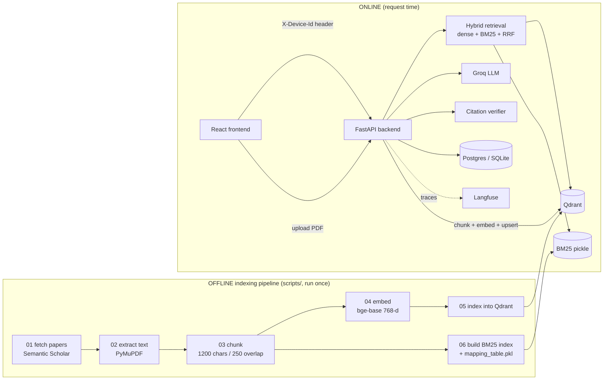

# QueryDocsAI: The Complete Interview Guide

This document explains the whole project from zero. It assumes you know nothing about RAG, vector
databases or LLM evaluation. Read it top to bottom once, then use the **Interview Questions** section
(Part 10) to practise.

---

## Table of contents

1. [The 30-second pitch](#1-the-30-second-pitch)
2. [Background concepts (start here if you are new)](#2-background-concepts)
3. [Objectives and requirements](#3-objectives-and-requirements)
4. [Tech stack and why each piece was chosen](#4-tech-stack)
5. [Architecture](#5-architecture)
6. [The flows, step by step](#6-the-flows-step-by-step)
7. [Evaluation methodology](#7-evaluation-methodology)
8. [Observability and tracing](#8-observability-and-tracing)
9. [Optimizations: what, why and how](#9-optimizations)
10. [Interview questions with answers](#10-interview-questions)
11. [Bugs we found and fixed (your best interview stories)](#11-bugs-we-found-and-fixed)
12. [Known limitations and what I would do next](#12-known-limitations-and-next-steps)
13. [Glossary](#13-glossary)

---

## 1. The 30-second pitch

> QueryDocsAI is a **Retrieval-Augmented Generation (RAG)** chatbot that answers questions over a
> corpus of about 70 consciousness and neuroscience research papers (about 6,400 text chunks), and over
> PDFs that a user uploads into a chat. Every answer must **cite the exact chunks** it came from. If the
> documents do not contain the answer, it must say *"I cannot find the answer in the provided
> documents."* instead of making something up.
>
> It uses **hybrid retrieval**: dense vector search in Qdrant plus BM25 keyword search, fused with
> Reciprocal Rank Fusion. Answers are generated by an LLM on **Groq**, and every citation is
> **verified** against what was actually retrieved. It has a FastAPI backend and a React frontend. I
> built an **evaluation harness** that scores several LLMs on frozen retrieval context with
> deterministic checks plus an LLM judge. I also added **Langfuse tracing** for observability.

Use the analogy: *"It's a small, domain-specific Google NotebookLM that I built end to end, so I
understand every layer."*

---

## 2. Background concepts

### 2.1 What is an LLM and why can't we just ask it?

A **Large Language Model** (GPT, Llama, Qwen…) predicts the next word based on patterns learned during
training. Two problems make it unsafe for research questions:

1. **Hallucination.** It produces fluent, confident text even when it doesn't know. It will invent a
   paper, a number or an author.
2. **Knowledge cutoff and no private data.** It only knows what was in its training data. It has never
   seen *your* PDFs, and it can't tell you where a fact came from.

### 2.2 What is RAG?

**Retrieval-Augmented Generation** fixes both problems with an "open-book exam" approach:

1. **Retrieve.** Search your own documents for the passages most relevant to the question.
2. **Augment.** Paste those passages into the prompt as context.
3. **Generate.** Tell the LLM: *answer only from this context, and cite it.*

The LLM becomes a **reader and summarizer** of evidence you supplied, not an oracle. Because you know
which passages you gave it, you can check the citations.

### 2.3 Chunking

A paper is far too long to fit in a prompt, and you want to retrieve *the paragraph that answers the
question*, not a whole 40-page PDF. So every document is split into **chunks**, here about 1,200
characters each with 250 characters of **overlap**.

- **Why overlap?** If a key sentence straddles a chunk boundary, the overlap means it appears whole in
  at least one chunk.
- **Why `RecursiveCharacterTextSplitter`?** It tries to split on paragraph breaks first, then lines,
  then sentences, then words. Chunks therefore end at natural boundaries instead of mid-word.

### 2.4 Embeddings and dense (semantic) search

An **embedding model** turns text into a vector: a list of numbers, here **768** numbers from
`BAAI/bge-base-en-v1.5`. Texts with similar *meaning* end up as vectors pointing in similar
directions, even when they share no words. "heart attack" and "myocardial infarction" land close
together.

**Dense search** embeds the question and finds the chunks whose vectors are closest, using **cosine
similarity** (the angle between vectors). We normalize every vector to length 1, so cosine similarity
equals a simple dot product, which is fast.

### 2.5 Vector database (Qdrant)

Comparing a question against millions of vectors one by one is slow. A **vector database** like
**Qdrant** stores the vectors in an **HNSW index** (Hierarchical Navigable Small World graph). It can
find the approximate nearest neighbours in milliseconds. Qdrant also stores a **payload** (JSON
metadata) with each vector, and lets you **filter** on it, e.g. "only chunks where
`source = corpus` or `chat_id = X`".

### 2.6 Sparse (keyword) search: BM25

**BM25** is the classic search-engine ranking function, an improved TF-IDF. A chunk scores high if it
contains the query's words (**term frequency**), especially *rare* words (**inverse document
frequency**). Very long chunks are penalized so they don't win by sheer size.

- **Strength:** exact terms such as acronyms ("GNWT"), names ("Jerath"), numbers ("622") and jargon.
  Embeddings often blur these.
- **Weakness:** no understanding of synonyms or paraphrase.

### 2.7 Hybrid search and Reciprocal Rank Fusion (RRF)

Dense and sparse search fail in *different* ways, so we run **both** and merge the results. That is
**hybrid retrieval**.

The problem is that their scores aren't comparable: cosine similarity is between 0 and 1, while BM25
scores are unbounded. **Reciprocal Rank Fusion** ignores the raw scores and uses only **ranks**:

```
RRF_score(chunk) = Σ over each result list  1 / (k + rank_in_that_list)      (k = 60)
```

A chunk ranked #1 by dense search and #3 by BM25 scores 1/61 + 1/63. A chunk that appears in both
lists beats one that tops only a single list. `k = 60` is the standard constant from the original RRF
paper (Cormack et al., 2009). It stops the #1 position from dominating everything.

### 2.8 Grounding and citations

**Grounded** means every claim in the answer is supported by the retrieved text. We force the LLM to
tag each claim with `[chunk: <id>]`. Then **our own code**, not the LLM, checks that each cited ID was
actually among the retrieved chunks. Any citation that wasn't is a *hallucinated citation* and gets
stripped out.

### 2.9 Evaluation ("evals")

How do you know the system is good, or that a change made it better? With an **eval set**: a fixed list
of questions with known answers that you run the system against, scored automatically. Part 7 covers
this in depth. It is the most interview-worthy part of the project.

---

## 3. Objectives and requirements

From `Docs/PRD.md`:

| Goal | How the project meets it |
|---|---|
| Answer questions using **only** the paper corpus | The system prompt forbids outside knowledge; only retrieved chunks are given to the model |
| **Every** claim cites its source | `[chunk: id]` contract plus `citation_verifier.py` |
| Say "not found" instead of guessing | An exact refusal sentence, detected by `ask.py` (`answer_found`) |
| Be measurably better than naive RAG | The eval harness in `eval/rag_eval/` |
| Ask questions about your *own* PDF (v2) | The upload pipeline, with chunks scoped to a chat via a Qdrant payload filter |
| Fast responses (PRD target about 5–8 s) | Groq inference, lazy singletons, a precomputed BM25 index |

**Non-goals:** no login (anonymous device IDs instead) and English only.

---

## 4. Tech stack

| Layer | Technology | Why this choice |
|---|---|---|
| Backend API | **FastAPI** (Python) | Async-capable, automatic request/response validation with Pydantic, auto-generated OpenAPI docs at `/docs`, and Python is where all the ML libraries live |
| Validation / schemas | **Pydantic** (`backend/models/schemas.py`) | Typed request/response contracts (`AskRequest`, `AskResponse`, `Citation`) |
| Database (app data) | **SQLAlchemy** ORM + **Postgres/Supabase** (SQLite also works) | Chats, messages and documents are relational data with ownership and cascading deletes |
| Vector DB | **Qdrant** (Docker) | Fast HNSW search, payload filtering, runs locally with one `docker compose up`, free |
| Embeddings | **BAAI/bge-base-en-v1.5** via `sentence-transformers` | Strong open-source retrieval model, 768 dimensions, runs on CPU, no API cost |
| Keyword search | **rank_bm25** (`BM25Okapi`), pickled | Simple and exact; precomputed offline so queries only score, never rebuild |
| LLM inference | **Groq** API (default `openai/gpt-oss-120b`) | Groq runs models on custom LPU hardware, giving very low latency and a free tier; the API is OpenAI-compatible |
| PDF parsing | **PyMuPDF** (`fitz`) | Fast and reliable text extraction |
| Chunking | **LangChain `RecursiveCharacterTextSplitter`** | Splits on natural boundaries; we use only this one LangChain utility, not the whole framework |
| Frontend | **React 19 + Vite + Tailwind CSS v4** | Vite gives a fast dev server; Tailwind for styling without writing CSS files |
| Paper source | **Semantic Scholar API** | Free, has open-access PDF links and metadata (title, authors, year) |
| Tracing | **Langfuse** | Open-source LLM observability: traces, latency, tokens, cost; self-hostable |
| Evaluation | Custom harness (`eval/rag_eval/`) + Groq LLM-as-judge | Deterministic, cheap, CI-friendly; an older DeepEval suite also exists |
| CI | **GitHub Actions** (`.github/workflows/eval.yml`) | Runs the eval and fails the build if accuracy drops below a threshold |

---

## 5. Architecture

### 5.1 The big picture



### 5.2 Folder map

```
backend/
  main.py                  FastAPI app, CORS, creates DB tables at startup
  config.py                loads .env (GROQ_API_KEY, GROQ_MODEL, ...)
  routes/ask.py            POST /ask: the main RAG endpoint
  routes/chats.py          create/list/rename/delete chats, get messages
  routes/documents.py      upload/list/delete PDFs in a chat
  retrieval/hybrid.py      dense + sparse + RRF + upload handling (the heart)
  generation/prompt_templates.py   system prompt + how chunks are formatted
  generation/groq_client.py        calls the LLM
  generation/citation_verifier.py  checks [chunk: id] tags
  ingestion/pipeline.py    PDF -> chunks -> embeddings (for uploads)
  ingestion/qdrant_utils.py upsert/delete upload points
  db/models.py, session.py, deps.py   SQLAlchemy models + device identity
  observability/           JSON-log tracing + metrics module (present, not wired in)
frontend/src/
  api/                     apiFetch wrapper + per-resource API calls
  hooks/                   useChats, useMessages, useDocuments (state)
  components/              ChatHistorySidebar, ChatWindow, DocumentsSidebar
scripts/                   offline pipeline 01..07 + docker-compose for Qdrant
data/                      metadata.csv, pdf_to_paperid.json, bm25_index.pkl, mapping_table.pkl
eval/rag_eval/             the evaluation harness (Part 7)
```

### 5.3 Data model (`backend/db/models.py`)

```
Device (device_id)                         <- anonymous browser identity
  └── Chat (chat_id, title, timestamps)    ON DELETE CASCADE
        ├── Message (role, content, citations JSON, answer_found)
        └── Document (filename, page_count, chunk_count)
```

**Identity without login:** the frontend generates a UUID once and stores it in `localStorage`
(`frontend/src/api/deviceId.js`). `apiFetch` sends it as an `X-Device-Id` header on every request.
`get_current_device` (`backend/db/deps.py`) creates the device row the first time it sees the ID.
Every route checks that the chat belongs to that device.

- *Trade-off to mention:* this isn't real authentication. Anyone who copies the UUID gets access. It's
  fine for a demo; production would use OAuth or JWT.

### 5.4 Where each kind of data lives

| Data | Store | Why there |
|---|---|---|
| Chunk vectors (corpus and uploads) | Qdrant collection `docs_collections` | Needs nearest-neighbour search |
| Corpus chunk text | `data/mapping_table.pkl` | Corpus points have no text in their payload, so text is looked up by `chunk_id` |
| Upload chunk text | Qdrant payload (`text`, `chunk_id`, `chat_id`, `doc_id`) | Uploads aren't in the pickle |
| BM25 index | `data/bm25_index.pkl` | Built offline, loaded once |
| Paper metadata | `data/metadata.csv` + `pdf_to_paperid.json` | Turns `28data_c11` into title, authors and year |
| Chats, messages, citations | SQL database | Relational data with ownership |

**Point IDs:** every Qdrant point ID is `uuid5(NAMESPACE_DNS, chunk_id)`. It's **deterministic**: the
same chunk always gets the same ID. Re-indexing therefore **overwrites instead of duplicating**
(idempotent upserts), and a chunk ID can be turned back into a point ID without a lookup table.

---

## 6. The flows, step by step

### 6.1 Offline indexing (`scripts/`)

| Step | Script | Input → output |
|---|---|---|
| 01 | `01_fetch_papers.py` | Semantic Scholar search → `metadata.csv` + PDFs (run manually) |
| 02 | `02_extract_text.py` | PDFs → `.txt` (all pages joined, which is why `page` is always `None`) |
| 03 | `03_chunks_text.py` | text → `.jsonl` chunks (1200/250), IDs like `28data_c11` |
| 04 | `04_build_embedding.py` | chunks → 768-d vectors (batch size 32, normalized) |
| 05 | `05_index_qdrant.py` | vectors → Qdrant, upserted in batches |
| 06 | `06_build_bm25_index.py` | chunks → `bm25_index.pkl` + `mapping_table.pkl` |
| 07 | `07_running_pipeline.py` | runs 02–06 in order |

**Why offline?** Embedding 6,400 chunks and building BM25 takes minutes. Doing it once, ahead of time,
keeps each request fast: a query only embeds **one** sentence.

### 6.2 Asking a question: `POST /ask` (`backend/routes/ask.py`)

```
Browser ──POST /ask {chat_id, question}, X-Device-Id──► FastAPI
  1. Auth/ownership: chat must belong to this device, else 404
  2. retrieve(question, chat_id)                 hybrid.py
  3. generate_answer(question, chunks)           groq_client.py
  4. verify_citations(raw_answer, chunks)        citation_verifier.py
  5. build citation list (paper title, authors, year per valid chunk)
  6. answer_found = "cannot find the answer" not in answer
  7. save the user message + assistant message (with citations) to the DB
  8. auto-title the chat from its first question
  9. return {answer, citations, answer_found}
```

#### Inside `retrieve()` (`backend/retrieval/hybrid.py`)

1. **Embed the query** with the BGE **query prefix**: `"Represent this sentence for searching relevant
   passages: " + question`. BGE was trained with this asymmetry: queries get the prefix and passages
   don't. Leaving it off measurably hurts retrieval.
2. **Dense search** in Qdrant with a **payload filter**:
   - no chat → `source = corpus` only
   - inside a chat → `source = corpus` **OR** `chat_id = <this chat>`

   It takes the top 20 (`CANDIDATE_POOL_SIZE`). The filter stops a user from ever retrieving another
   user's upload.
3. **Upload search** (when in a chat): a second Qdrant query filtered to `chat_id = this chat` only,
   for the top `top_k − 2`.
4. **Sparse search**: tokenize (lowercase, strip punctuation), score every corpus chunk with BM25, and
   take the top 20 with a score above 0.
5. **RRF fusion** of the dense and sparse lists.
6. **Pin uploads first**: this chat's upload chunks take the first slots, and the best corpus chunks
   fill the rest up to `top_k`. Part 9 and Part 11 explain why.
7. **Resolve metadata**: corpus chunk `28data_c11` → stem `28data` → `pdf_to_paperid.json` → paper ID →
   `metadata.csv` → title, authors, year. Upload chunks take the filename from the payload.

#### Inside generation (`prompt_templates.py` + `groq_client.py`)

The **system prompt** sets the rules:

1. Answer only from the context.
2. Cite every claim as `[chunk: <chunk_id>]`.
3. If the answer isn't there, reply *exactly* "I cannot find the answer in the provided documents."
4. Never invent chunk IDs.

Each chunk is formatted as `[chunk: 28data_c11] (Author, Year)\n"text…"`, so the model sees the exact
IDs it is allowed to cite. Temperature is low (0.2 in the app, 0 in evals) because this is
factual Q&A, not creative writing.

#### Inside `verify_citations()`

A regex finds every `[chunk: id]` tag. It also accepts the full-width `【chunk: id】` brackets that
GPT-OSS models emit, and IDs that contain dots, like `1705.04742_c29`. Then:

- **valid** (the ID was retrieved) → kept, normalized to `[chunk: id]`
- **hallucinated** (the ID wasn't retrieved) → **stripped from the answer**

This is a **cheap, deterministic guardrail**: plain code checks the LLM's citations.

> **Contract coupling:** the prompt wording, the verifier regex and `ask.py`'s `"cannot find the
> answer"` check must agree. If you change one, change all three. This exact drift caused a real bug
> (Part 11).

### 6.3 Uploading a PDF (`routes/documents.py` → `ingestion/pipeline.py`)

```
PDF bytes ─► PyMuPDF extract text ─► split 1200/250 ─► BGE embed (no prefix)
         ─► points {id: uuid5(chunk_id), vector, payload{source:"upload", chat_id,
                    doc_id, chunk_id:"upload_<doc_id>_c<n>", text, filename}}
         ─► upsert into the SAME Qdrant collection ─► Document row in SQL
```

- **Delete** removes the Qdrant points first, then the DB row. If the second step fails, you're left
  with an orphaned DB row rather than orphaned vectors that could still be retrieved.
- Uploads are **not** added to BM25, because the BM25 pickle is static. That's why uploads need
  special handling in ranking (Part 9).

### 6.4 Frontend

- `api/client.js`: `apiFetch()` adds the base URL (`VITE_API_BASE_URL`) and the `X-Device-Id` header.
- `api/*Api.js`: one small module per resource (ask, chats, documents).
- `hooks/useChats`, `useMessages`, `useDocuments`: hold state and call the APIs.
- `App.jsx`: lays out three panes: chat history, chat window and documents sidebar.
- Chats are titled **server-side** from the first question, so titles survive a page refresh.

---

## 7. Evaluation methodology

This is where you stand out in an interview. Most RAG demos have no evaluation at all.

### 7.1 Core idea: separate retrieval from generation

A RAG answer can be wrong for two different reasons:

1. **Retrieval failed**: the right passage was never fetched.
2. **Generation failed**: the passage was there, but the LLM misread it, made something up or didn't
   cite it.

If you only score the final answer, you can't tell these apart. So the harness:

1. **Freezes retrieval** (`make_golden_dataset.py`). It runs `retrieve()` **once** per question and
   saves the retrieved chunks into `golden_dataset.csv` (`context_json`).
2. **Scores every LLM on the identical frozen context** (`main.py`).

Benefits:

- **Fair model comparison**: every model reads exactly the same evidence.
- **Reproducible**: no Qdrant or embedder needed at eval time, so it runs in CI.
- **Cheap**: retrieval cost is paid once.
- **Diagnosable**: retrieval metrics and generation metrics are reported separately.

### 7.2 The golden dataset (`golden_dataset_generator.py`)

35 questions, each with a reference answer, the **source paper** that contains it, and **key-fact
regexes**:

| Difficulty | Count | What it tests |
|---|---|---|
| easy | 7 | a single definitional fact |
| hard | 8 | multi-part answers, contrasts, specific details |
| negative | 5 | not in the corpus; the model **must refuse** |
| upload | 5 | asked inside a chat with an uploaded (made-up) resume; includes a refusal case and a corpus question asked inside the upload chat |
| complex | 10 | summaries, five-item lists, numbers, partial context, two-paper questions |

For the upload questions, `make_golden_dataset.py` generates a small made-up resume PDF in code and
ingests it through the **real** upload pipeline under a fixed `chat_id` (`eval-upload-chat`). That
exercises the production path end to end, and no private file is committed.

### 7.3 The grading cascade (`evaluator.py`)

Each answer goes through ordered, **deterministic** checks. The first failure decides the verdict:

```
1. Refusal      negative question? must refuse   -> refusal_ok / missed_refusal
                answerable question but refused  -> false_refusal
2. Citations    no [chunk:] tags                 -> no_citation
                cites a chunk not retrieved      -> hallucinated_citation
3. Grounding    cites the right SOURCE paper?    -> wrong_source
4. Correctness  all key-fact regexes match?      -> missing_key_fact
                otherwise                        -> match (correct)
```

**Why deterministic instead of an LLM judge for pass/fail?** Regexes and set checks are free, instant,
reproducible and unbiased. The same answer always gets the same verdict, so CI never flakes. The LLM
judge is an *added* layer, not the pass/fail gate.

### 7.4 Metrics, and what each one means

**Retrieval** (computed from the frozen context):

| Metric | Definition | Last value |
|---|---|---|
| **Recall@k** (hit rate) | share of answerable questions where *any* chunk from the gold source paper is in the top k | 94.7% (25 Qs) → 89.7% after adding the harder questions |
| **Precision@k** | average share of the k retrieved chunks that come from the gold source | 50.5% (25 Qs) |
| **MRR** | Mean Reciprocal Rank: 1 / (position of the first gold-source chunk), averaged | 0.816 (25 Qs) |

**Generation** (per model):

| Metric | Definition |
|---|---|
| **Accuracy** | share of questions that pass the whole cascade |
| **Citation precision** | valid citations / all citations |
| **Answer recall** | token overlap between the answer and the reference answer (a soft score) |
| **Faithfulness** (LLM judge) | supported claims / total claims, judged against the retrieved context |
| **Answer relevancy** (LLM judge) | how directly and completely the answer addresses the question |

### 7.5 LLM-as-judge (`judge.py`)

One Groq call per answer returns JSON `{faithfulness, answer_relevancy, reason}`. Design choices:

- `temperature=0` and `response_format=json_object`, for stable, parseable output.
- **Refusals aren't judged**, since there are no claims to check. *Exception:* a false refusal that
  **also contains content** is judged, because hidden hallucinations live there. (A real example:
  Qwen refused and then named a researcher from the wrong paper.)
- Scores are clamped to [0, 1].
- **Validating the judge.** I fed it known-bad answers:

  | Answer given to the judge | Faithfulness score |
  |---|---|
  | correct | 1.0 |
  | correct + one invented claim | 0.5 |
  | correct + two invented claims | 0.33 |
  | wrong | 0.0 |
  | off-topic | 0.0 |

  **Always validate your judge before trusting it.**

### 7.6 Results so far (25-question run, before the complex questions)

| Model | Accuracy | Faithfulness | Relevancy | Citation precision |
|---|---|---|---|---|
| GPT-OSS 20B | 96% | 100% | 100% | 100% |
| Qwen3.8 27B | 96% | 100% | 100% | 100% |
| GPT-OSS 120B | 92% | 100% | 100% | 100% |
| ALLaM 2 7B | 16% | 72% | 40% | 25% |

**How to talk about the 100%s honestly:** the judge *does* catch invented claims (see the test above).
The perfect scores reflect easy single-fact questions with good context. That's exactly why I added
the 10 complex questions. They immediately showed a **retrieval** gap: the Cogitate paper wasn't
retrieved for its own two questions.

### 7.7 Running it

```bash
python -m eval.rag_eval.golden_dataset_generator        # validate the question set
python -m eval.rag_eval.make_golden_dataset             # freeze retrieval (needs Qdrant)
python -m eval.rag_eval.main                            # all models, deterministic checks
python -m eval.rag_eval.main --judge                    # + faithfulness / relevancy
python -m eval.rag_eval.main --rescore [--judge]        # re-grade saved answers, no regeneration
python -m eval.rag_eval.main --threshold 0.6            # exit 1 if any model is below 60% (CI gate)
```

**CI:** `.github/workflows/eval.yml` runs the eval for GPT-OSS 120B with `--threshold 0.6`. A prompt
or model change that breaks quality fails the build. This is **regression testing for an AI
system**.

---

## 8. Observability and tracing

**Observability** means being able to answer *"what exactly happened on this request, and why?"* from
production data, without reproducing it locally.

### 8.1 Langfuse tracing (wired in)

Functions are wrapped with Langfuse's `@observe` decorator, which builds a **trace tree** for every
request:

```
ask                (span)       input: question, chat_id
│                               metadata: answer_found, valid_citations,
│                                         hallucinated_citations, upload_chunks
├── retrieve       (retriever)  input question, output chunks, latency
├── generate_answer(generation) model, temperature, max_tokens,
│                               input/output TOKENS -> Langfuse computes COST
└── verify_citations (span)     which citations survived
```

Eval runs are traced too, including `judge` as an `evaluator` span.

- **Enable it:** set `LANGFUSE_PUBLIC_KEY`, `LANGFUSE_SECRET_KEY` and `LANGFUSE_HOST` in `.env`.
- **Without keys** the SDK disables itself, so the app runs normally with zero overhead.

**What you can answer with it:**

- p50/p95 latency per step: is the slowness in retrieval or in the LLM?
- tokens and cost per request and per model
- the hallucinated-citation rate over time
- the refusal rate, which is a proxy for retrieval coverage
- the exact chunks behind any bad answer a user reports

### 8.2 The `backend/observability/` module (present, not wired in)

A dependency-free alternative from an earlier commit: JSON-line request traces (`tracing.py`) and an
in-process rolling window for latency percentiles and cost (`metrics.py`).

- It isn't imported anywhere.
- `metrics.py` used to import a `GROQ_PRICING_PER_1M` constant that didn't exist, so it crashed on
  import. That constant now exists in `config.py` as an empty table. Fill it from Groq's pricing page;
  models not listed are costed at $0.

*Interview angle:* "I chose Langfuse over hand-rolled metrics because it gives trace trees, cost and
dashboards out of the box. The hand-rolled module would be a fallback where no external service is
allowed."

---

## 9. Optimizations

For each one: **what** it is, **why** it matters, and **how** it's done here.

### 9.1 Retrieval quality

| # | Optimization | Why | How |
|---|---|---|---|
| 1 | **Hybrid retrieval** (dense + BM25) | Dense search misses exact terms (acronyms, names, numbers); BM25 misses paraphrases. Together they cover each other's blind spots | Both run in `retrieve()`, top 20 each |
| 2 | **RRF fusion** instead of score averaging | Cosine and BM25 scores live on different scales; adding them is meaningless. Ranks are comparable | `1/(60+rank)` summed across lists |
| 3 | **Candidate pool (20) larger than top_k (5–7)** | Fusion needs room: a chunk ranked #15 by dense and #2 by BM25 should be able to win | `CANDIDATE_POOL_SIZE = 20` |
| 4 | **BGE query prefix** | BGE was trained with asymmetric query/passage encoding; the prefix measurably improves recall | `BGE_QUERY_PREFIX + question` for queries only |
| 5 | **Normalized embeddings** | Cosine similarity becomes a plain dot product, which is cheaper and consistent between indexing and querying | `normalize_embeddings=True` everywhere |
| 6 | **Chunk size 1200, overlap 250** | Too small loses context; too large dilutes relevance and wastes prompt tokens. Overlap prevents facts being cut in half | `RecursiveCharacterTextSplitter` |
| 7 | **Upload pinning** | Uploads get no BM25 score, so RRF always ranked them below corpus chunks, and the user's own PDF never reached the LLM | Separate chat-only Qdrant query; uploads fill the first `top_k−2` slots, corpus fills the rest |

### 9.2 Latency and performance

| # | Optimization | Why | How |
|---|---|---|---|
| 8 | **Offline indexing** | Embedding thousands of chunks takes minutes; a request should only embed one sentence | `scripts/01–07` |
| 9 | **Lazy singletons** | Loading the embedding model (~400 MB) or unpickling BM25 per request would add seconds | `_get_model()`, `_get_bm25()`, `_get_qdrant_client()` load once per process |
| 10 | **Precomputed BM25 pickle** | Building BM25 means tokenizing the whole corpus; a query only needs scoring | `06_build_bm25_index.py` → `bm25_index.pkl` |
| 11 | **HNSW index in Qdrant** | Exact nearest-neighbour search is O(N); HNSW is roughly logarithmic | Qdrant's default index |
| 12 | **Payload filter inside the search**, not after it | Filtering after the search can leave fewer than k results and wastes work; Qdrant filters during graph traversal | `query_filter=Filter(should=[...])` |
| 13 | **Groq inference** | LPU hardware gives very high tokens per second, the biggest single latency win | `groq_client.py` |
| 14 | **Deterministic `uuid5` point IDs** | Re-indexing overwrites instead of duplicating; no ID lookup table needed | `uuid5(NAMESPACE_DNS, chunk_id)` |
| 15 | **One-time payload migration** | Backfilling `source` on every point is a full scan, so it runs once per process | `_corpus_payload_migrated` flag |

*Fixed:* `retrieve()` used to rebuild a `uuid → chunk` dict and copy all 6,400 chunk texts **on every
call**, two loops over the whole corpus per request. Both lookup dicts are now built once, together
with the BM25 singleton, and only the top-k chunks' text is looked up. Retrieval output is identical
(verified against the frozen eval context), and a warm `retrieve()` takes about 75 ms.

### 9.3 Cost

| # | Optimization | Why | How |
|---|---|---|---|
| 16 | **Frozen eval context** | Re-running retrieval for every model × question wastes time and makes runs non-comparable | `golden_dataset.csv` |
| 17 | **`--rescore`** | After changing the grader, re-grade saved answers with **zero** LLM calls | `rescore()` in `main.py` |
| 18 | **Rate-limit and network-aware retry** | Groq's free tier returns HTTP 429 with "try again in X s"; we parse X and sleep exactly that long, with exponential backoff as a fallback. A network drop backs off for about 6 minutes, then **aborts the run without overwriting** `eval_results.csv`, instead of recording every remaining question as a wrong answer | `with_retry()` + `NetworkDown` |
| 19 | **Per-model `max_tokens`** | Small-context models (ALLaM, 4k) overflow otherwise; reasoning models need room to think | `MAX_TOKENS` in `models.py` |
| 20 | **One judge call for two metrics** | Faithfulness and relevancy come from a single JSON response, halving judge cost | `judge.py` |

### 9.4 Safety and correctness

| # | Optimization | Why | How |
|---|---|---|---|
| 21 | **Citation verification in code** | Never trust the LLM to police itself; a set-membership check is free and exact | `citation_verifier.py` |
| 22 | **Exact refusal sentence** | Easy to detect reliably (`answer_found`) instead of guessing whether the model gave up | System prompt rule 3 |
| 23 | **Low temperature** | Factual Q&A wants the most likely, grounded wording, not creativity | 0.2 in the app, 0 in evals |
| 24 | **Tenant isolation via payload filter** | One shared collection is simpler than one per chat, but must never leak data across chats | The filter is always applied; `source=corpus` when there's no chat |

### 9.5 Optimizations I would add next (great "what would you improve?" answers)

- **Cross-encoder reranker** (e.g. `bge-reranker-base`): retrieve 30, rerank, keep 5. This is the
  biggest quality lever and would directly fix the precision@5 of about 50%.
- **Query rewriting / HyDE** for vague or multi-part questions, such as the two-paper questions that
  currently miss.
- **Response caching**: cache by (question hash, chat_id) for repeated questions.
- **Streaming answers** (Server-Sent Events): perceived latency drops to time-to-first-token.
- **Async I/O**: Qdrant and Groq both have async clients, so one worker could serve many concurrent
  requests.
- **Incremental BM25** that includes uploads, or a sparse vector index in Qdrant, instead of a static
  pickle.
- **Per-page chunking** so citations can show page numbers (`page` is currently always `None`).
- **Vector quantization** in Qdrant (scalar or binary) for lower RAM at scale.
- **Model routing**: the eval shows GPT-OSS 20B matches 120B on accuracy, so serving 20B by default
  would cut cost and latency with no measured quality loss.

---

## 10. Interview questions

### A. Fundamentals

**Q1. What is RAG, and why use it instead of fine-tuning?**
RAG retrieves relevant documents at query time and gives them to the LLM as context. Fine-tuning
changes the model's weights. Use RAG when:
- knowledge changes (just re-index),
- you need **citations** (you know which passages were used),
- you have private data,
- you want to cut hallucinations (grounding).

Fine-tuning teaches *style or behaviour*. It doesn't add reliably citable facts, it's expensive, and
you'd have to retrain whenever the data changes.

**Q2. What is an embedding?**
A fixed-length vector (768 numbers here) that represents meaning. Texts with similar meanings have
vectors with high cosine similarity.

**Q3. Cosine similarity vs dot product vs Euclidean distance?**
- Cosine measures the angle and ignores length.
- For **normalized** vectors, cosine equals the dot product, and Euclidean distance ranks results in
  the same order.
- We normalize, so we can use the cheapest operation.

**Q4. Explain BM25.**
A ranking function that rewards term frequency, with diminishing returns (`k1`), and rare terms
(IDF). It also normalizes by document length (`b`), so long chunks don't win by size alone.

**Q5. Why hybrid search?**
Dense search understands paraphrase but blurs exact tokens. BM25 nails exact tokens but has no idea
of synonyms. Their failures are largely independent, so combining them improves recall.

**Q6. Why RRF and not a weighted sum of scores?**
The scores are on different, unbounded scales, so a weighted sum needs calibration and per-dataset
tuning. RRF uses only ranks, has one robust constant (k=60), and rewards agreement between
retrievers.

**Q7. What does `k=60` do in RRF?**
It damps the advantage of top ranks. With k=0, rank 1 would be worth 1.0 and rank 2 only 0.5, a huge
gap. With k=60, the gap is 1/61 vs 1/62. That makes fusion reward chunks found by *both* retrievers
more than a chunk that tops only one list.

**Q8. How did you choose chunk size and overlap?**
1200 characters is about 250–300 tokens: roughly a paragraph, enough for one complete idea. 250
characters of overlap stops a sentence being cut in half at a boundary. The trade-off: smaller chunks
are more precise but lose context, and larger chunks waste prompt tokens and dilute relevance. The
right way to tune them is to measure recall@k on the eval set while varying them.

**Q9. What is HNSW?**
A multi-layer graph index for approximate nearest-neighbour search. The top layers are sparse
"highways" and the lower layers are dense. A search greedily walks down the layers, giving roughly
logarithmic query time in exchange for a tiny loss of exactness.

**Q10. Why the BGE query prefix?**
BGE was trained with an instruction prefix on queries but not on passages. Matching the training
setup improves retrieval. Passages must **not** get the prefix.

### B. Architecture and design

**Q11. Walk me through what happens when a user asks a question.**
Use section 6.2:
1. ownership check
2. hybrid retrieve (with the chat filter and upload pinning)
3. Groq generation with the citation rules
4. citation verification
5. build citations from metadata
6. save both messages
7. respond

**Q12. Why one Qdrant collection for corpus and uploads instead of a collection per chat?**
It's simpler to manage, there's one search call, and corpus and uploads are searched together.
Isolation is enforced with a **payload filter** (`source=corpus OR chat_id=X`). The trade-off is that
a filter bug leaks data, and that actually happened (Q30). With many tenants, you'd use Qdrant's
multitenancy features with a payload index on `chat_id`.

**Q13. Why are point IDs `uuid5(chunk_id)`?**
They're deterministic, so re-indexing is idempotent (overwrites, never duplicates), and a chunk ID
can be turned into a point ID without a lookup table.

**Q14. How does identity work without login? Is it secure?**
A UUID kept in localStorage is sent as `X-Device-Id`, and every route checks ownership. It isn't
secure against anyone who obtains the UUID. That's fine for a demo; production needs real auth
(OAuth/JWT) with the device ID replaced by a user ID.

**Q15. Why delete Qdrant points before the DB row when deleting a document?**
If the second step fails, an orphaned DB row is harmless and visible, and the user can retry.
Orphaned vectors would be invisible yet still retrievable, which is a correctness and privacy problem.

**Q16. Why FastAPI?**
Pydantic validation, auto-generated docs, dependency injection (`Depends(get_db)`,
`Depends(get_current_device)`), async support, and it's Python, where the ML stack lives.

**Q17. Why Groq?**
Very low latency from LPU hardware, an OpenAI-compatible API, a free tier, and open-weight models
(GPT-OSS, Qwen). The cost: a rate-limited free tier and a smaller model catalogue.

**Q18. Why is the BM25 index a pickle, and what's the downside?**
It's fast to load and simple. The downsides: it's static, so uploads aren't in it (which is why they
needed special ranking), it has to be fully rebuilt to add documents, and pickle shouldn't be loaded
from untrusted sources.

**Q19. How do uploaded documents compete with corpus documents in ranking?**
They don't get a BM25 score, so plain RRF ranked them too low. We run a separate chat-scoped search
and **pin** up to `top_k−2` upload chunks first, keeping 2 or more slots for the corpus. The
trade-off: corpus chunks next to the upload can still distract the model (seen in the eval with Qwen).

### C. LLM, prompting and hallucination

**Q20. How do you stop hallucination?**
Layered defences:
1. **retrieval grounding**: only relevant context is given
2. **system prompt**: answer only from the context, otherwise use the exact refusal sentence
3. **mandatory citations**
4. **verification in code**: strip citations to chunks that weren't retrieved
5. **evaluation**: measure faithfulness and the hallucinated-citation rate continuously

No single layer is enough.

**Q21. Can the citation verifier catch every hallucination?**
No. It only proves the cited *chunk was retrieved*. A model can cite a real chunk while saying
something that chunk doesn't support. That's what **faithfulness** (the LLM judge) measures. Be clear
about this distinction.

**Q22. Why an exact refusal sentence?**
So refusal can be detected reliably with a string check (`answer_found`, eval refusal scoring). Free
text like "unfortunately I'm not sure…" is hard to classify.

**Q23. Why temperature 0–0.2?**
Grounded factual Q&A wants the most probable, faithful wording. Higher temperature adds variety and
the risk of drifting. Evals use 0 for reproducibility.

### D. Evaluation (the most important section)

**Q24. How did you evaluate the system?**
Frozen-retrieval golden dataset → every model answers the same context → a deterministic cascade
(refusal → citations → source grounding → key facts) → an LLM judge for faithfulness and relevancy,
with retrieval precision, recall and MRR reported separately. It runs in CI with an accuracy threshold.

**Q25. Why freeze the retrieval context?**
- It isolates generation quality from retrieval quality.
- Every model is compared on identical evidence.
- It's reproducible and needs no Qdrant in CI.
- It's cheaper.

The downside: after re-indexing you must rebuild the frozen set.

**Q26. Explain precision@k, recall@k and MRR in your setup.**
- **Recall@k:** did *any* chunk from the gold paper appear in the top k? (89.7%)
- **Precision@k:** what share of the top-k chunks came from the gold paper? (about 50%)
- **MRR:** 1 / rank of the first gold chunk, averaged (0.816 on the 25-question set). The right
  evidence is usually ranked first.

**Q27. Deterministic checks or an LLM judge, which is better?**
Both, for different jobs:
- **Deterministic:** free, exact, reproducible, can't be gamed by phrasing. Good for pass/fail gates
  and CI.
- **LLM judges:** capture semantics (faithfulness, relevancy), but they cost money, add variance and
  have biases.

Use deterministic checks to gate and the LLM judge to diagnose.

**Q28. What biases does an LLM judge have, and how did you handle them?**
- **Self-preference:** a model rates its own outputs higher. Qwen judged itself, so use a judge that
  isn't being tested (`JUDGE_MODEL`).
- **Leniency or verbosity bias.**
- **Conflating relevancy with correctness:** it gave a wrong but on-topic answer 0 relevancy. I
  changed the judge prompt to score relevancy independently of correctness (not yet re-validated).

I **validated the judge** with known-bad answers (0.5 for one invented claim, 0.33 for two, 0 for off-topic).

**Q29. Three models scored 100% faithfulness. Is the system that good?**
Not necessarily. I checked that the judge isn't broken: it penalizes invented claims. The 100% came
from easy single-fact questions with good context and a small sample (about 20 answers per model). So
I added 10 complex questions (summaries, lists, numbers, partial context, two-paper). They
immediately exposed a retrieval gap. *Lesson: a perfect score usually means the test is too easy, not
that the system is perfect.*

**Q30. What's the difference between faithfulness and answer correctness?**
- **Faithfulness:** is the answer supported by the *retrieved context*?
- **Correctness:** does it match the *truth*, i.e. the reference answer?

An answer can be faithful but wrong (bad retrieval), or correct but unfaithful (the model used prior
knowledge). RAG cares most about faithfulness, because that's what makes answers checkable.

**Q31. How do you test refusal behaviour?**
Negative questions that aren't in the corpus (scored `refusal_ok` / `missed_refusal`), a
partial-context question (#33: answer one part, admit the other is missing), and a refusal case inside
an upload chat (the candidate's phone number). Also track false refusals on answerable questions.

**Q32. How would you evaluate retrieval changes, such as a new chunk size?**
Re-index, rebuild the frozen dataset, and compare recall@k, precision@k and MRR. Then run the
generation eval on the new context to confirm end-to-end accuracy didn't drop. Change one variable at
a time.

**Q33. Isn't tweaking the eval after seeing failures just cheating?**
It depends what you change.
- Fixing a **grader bug** that rejects a correct answer, applied as a general rule, is legitimate.
- Loosening a check **because one answer failed** is overfitting the test.
- Fixing the **system** is the goal.

I declined to loosen a key-fact regex for exactly this reason.

### E. Observability and production

**Q34. What would you monitor in production?**
- p50/p95 latency per stage (retrieve vs generate)
- tokens and cost per request and per model
- error rate
- refusal rate (a proxy for coverage gaps)
- hallucinated-citation rate
- citations per answer
- user feedback (thumbs up/down)

Plus **sampled online evaluation**: run the faithfulness judge on a share of real traffic.

**Q35. What's a trace, and what does yours contain?**
A tree of timed spans for one request: `ask` → `retrieve`, `generate_answer` (with model and token
usage, so cost) and `verify_citations`, plus metadata (answer_found, citation counts). With it you can
debug a specific bad answer by seeing exactly which chunks were retrieved and what the model produced.

**Q36. How would you scale this?**
- **Stateless API** behind a load balancer, with multiple workers.
- **Qdrant** as a managed cluster, with a payload index on `chat_id`.
- Move the embedding model to a **dedicated inference service** (or GPU) so each API worker doesn't
  load its own copy.
- Use **async** clients, a **response cache**, and **streaming**.
- **Background jobs** (a queue) for PDF ingestion, so uploads don't block requests.
- Replace the static BM25 pickle with Qdrant **sparse vectors**.

**Q37. How do you handle LLM rate limits?**
Parse the provider's "try again in X s" from the 429 error and sleep exactly that long, with
exponential backoff as a fallback and a capped number of attempts. In production you'd also add a
fallback model and a request queue.

### F. Behavioural / debugging stories

**Q38. Tell me about a hard bug you fixed.** Pick one from Part 11. Structure the answer as
symptom → hypothesis → evidence → root cause → fix → how you verified it.

**Q39. What would you do differently?**
- Add a reranker and evaluation from day one.
- Keep page numbers by chunking per page.
- Use one source of truth for the prompt/verifier contract (a shared constant plus a test).
- Add real auth.
- Write unit tests for `retrieve()` edge cases (uploads, filters).

**Q40. What did you learn?**
- Retrieval quality bounds answer quality.
- Never trust an LLM to verify itself.
- Evals must be validated and made harder until they discriminate.
- Small contract mismatches (prompt vs regex) silently break the whole system.

---

## 11. Bugs we found and fixed

These are real, and each makes a strong interview story.

### Bug 1: The chatbot ignored the user's uploaded resume

- **Symptom:** in a chat with an uploaded resume, *"what is the name of the candidate?"* returned
  "candidate marker", a phrase from a neuroscience paper. *"Which college?"* returned a researcher's
  biography.
- **Root cause:** upload chunks only get a dense score; corpus chunks get dense **plus** BM25, so
  roughly double the RRF score. The swap-in logic only promoted an upload chunk if it beat the weakest
  corpus chunk, which it almost never did. On top of that, 5 resume chunks were competing against
  about 6,400 corpus chunks in the dense top 20.
- **Fix:** a dedicated chat-scoped Qdrant query, with upload chunks pinned to the first `top_k−2`
  slots and the corpus filling the rest.
- **Verified:** retrieval for an upload chat now returns upload chunks first, and the eval has 5
  upload questions.

### Bug 2: The prompt and the citation verifier disagreed

- **Symptom:** answers showed citations like `[Document 13, Chunk 39]`.
- **Root cause:** someone changed the prompt to ask for `[Document X, Chunk Y]`, but the verifier only
  parsed `[chunk: id]`. **No citation was ever verified**, so fake ones went straight through.
- **Fix:** restored the `[chunk: id]` format in the prompt.
- **Lesson:** contracts that span components need a single source of truth and a test.

### Bug 3: GPT-OSS 120B scored 0%

- **Symptom:** every answer was marked `no_citation`, yet the answers were correct.
- **Root cause:**
  - GPT-OSS emits **full-width brackets** `【chunk: id】`.
  - Some chunk IDs contain **dots** (`1705.04742_c29`), which the regex `[\w\-]+` rejected.
- **Fix:** the regex accepts both bracket styles and dots, and valid tags are normalized to
  `[chunk: id]`.
- **Lesson:** a 0% score is more often a measurement bug than a model failure. Read the raw outputs.

### Bug 4: Users could retrieve other users' uploads (privacy)

- **Symptom:** found while rebuilding the eval: corpus-only questions retrieved
  `upload_<someone-else>` chunks.
- **Root cause 1:** with no `chat_id`, **no filter at all** was applied.
- **Root cause 2:** an earlier "backfill `source=corpus` onto every point without a source" migration
  had mislabelled older uploads as corpus.
- **Fix:** always filter `source=corpus` when there's no chat, and the migration now re-tags points
  whose `chunk_id` starts with `upload_` back to `source=upload`.
- **Verified:** after the rebuild, zero upload chunks appear in non-chat retrieval.
- **Lesson:** data migrations need guards; filters must default to *deny*.

### Bug 5: CI would have broken

The eval imports `langfuse` (tracing), but the CI job installed only `python-dotenv groq pandas`.
`langfuse` was added to the workflow's install step.

### Bug 6: Any device could list or upload documents in any chat

- **Root cause:** the ownership checks in `routes/documents.py` (upload and list) were commented out,
  probably because Swagger UI sent the chat ID wrapped in quotes and the lookup failed. The quote
  stripping was only applied in some places, so the `Document` row could be saved with the quoted ID.
- **Fix:** normalize `chat_id` once at the top of the handler, use it everywhere, and turn the checks
  back on.
- **Verified with a test client:** the owner gets 200; another device gets 404 for both list and
  upload.

### Smaller cleanups

- **Leftover debug code removed:** a large hard-coded sample chunk list and test query at the bottom
  of `groq_client.py` and `hybrid.py`. Python evaluated the chunk list every time the module was
  imported.
- **LLM judge:** the relevancy instructions now say to score relevancy independently of correctness.
  An on-topic but wrong answer is relevant; its wrongness belongs in faithfulness.

---

## 12. Known limitations and next steps

| Limitation | Impact | Next step |
|---|---|---|
| `page` is always `None` | Citations can't show page numbers | Chunk per page, store the page in the payload |
| Static BM25, uploads excluded | Uploads rely on dense search only | Qdrant sparse vectors / incremental BM25 |
| No reranker; precision@5 is about 50% | Half the context is off-target, which can distract the model | Cross-encoder rerank |
| Retrieval misses some papers (e.g. Cogitate questions retrieve 42data) | Multi-paper and complex questions fail | Reranker, query rewriting, eval-driven tuning |
| Corpus chunks next to uploads can distract the model | Qwen answered a resume question with a corpus researcher | A stronger prompt preference for uploads, or fewer corpus slots in upload chats |
| Device-ID identity | Not real auth | OAuth/JWT |
| Synchronous request path | Limited concurrency | Async clients, streaming |
| Small eval set (35 questions) | Wide confidence intervals | Grow the set; add sampled online evaluation |
| LLM judge may be lenient / self-biased | Inflated faithfulness | Independent judge model; human-labelled calibration set |

---

## 13. Glossary

| Term | Meaning |
|---|---|
| **RAG** | Retrieval-Augmented Generation: retrieve evidence, then let the LLM answer from it |
| **Chunk** | A small slice of a document (about 1,200 characters here) used as the unit of retrieval |
| **Embedding** | A vector representing the meaning of a text |
| **Dense retrieval** | Search by embedding similarity |
| **Sparse retrieval / BM25** | Keyword search based on term statistics |
| **Hybrid retrieval** | Dense + sparse combined |
| **RRF** | Reciprocal Rank Fusion: merges ranked lists with `Σ 1/(k+rank)` |
| **HNSW** | Graph index for fast approximate nearest-neighbour search |
| **Payload / filter** | Metadata stored with a vector; restricts which vectors a search can return |
| **Top-k** | How many chunks are passed to the LLM (5–7 here) |
| **Grounding** | Supporting each claim with retrieved evidence |
| **Hallucination** | Fluent but unsupported or false output |
| **Hallucinated citation** | A citation to a chunk that wasn't retrieved |
| **Faithfulness** | Share of the answer's claims supported by the context |
| **Answer relevancy** | How directly the answer addresses the question |
| **Recall@k / Precision@k / MRR** | Retrieval metrics (see 7.4) |
| **Golden dataset** | A fixed set of questions and reference answers for evaluation |
| **LLM-as-judge** | Using an LLM to grade another LLM's output |
| **Trace / span** | A recorded tree of timed steps for one request |
| **Idempotent** | Running an operation twice has the same effect as running it once |
| **Lazy singleton** | An object created on first use, then reused for the life of the process |
| **Tenant isolation** | Making sure one user's data is never visible to another |
